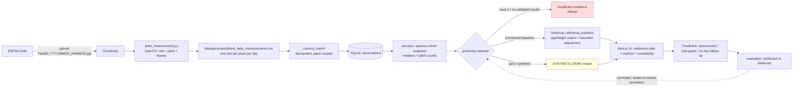

# Faculty Viva Q&A Guide — Plant Transplant Readiness Prediction System

**Repository:** `RKB-vision/PLANTING-WINDOW-PREDICTOR` (branch `main`)
**Document:** `FACULTY_VIVA_QA.md` (repository root)
**Prepared from the current implementation.** When documentation and code disagree, the code is the source of truth and the discrepancy is noted inline.

---

## Part 0 — Quick revision sheet

### A. Project in one minute

> This is a plant-monitoring system that estimates when a plant species is likely
> to be ready for transplantation. An ESP32-CAM photographs the plant, the image
> goes to Cloudinary, and an OpenCV pipeline measures height, stem width, and
> visible leaf count using a reference rod for scale. Those measurements become
> daily observations in a SQLite database. The system then compares the current
> plant against a successful historical cohort (10 Super Orange plants, 250
> observations over 25 days) and returns a provisional transplant-readiness
> date, together with the method, uncertainty, and limitations. There is **no
> trained real-data ML model** in the active prediction path yet — the core
> predictor is a deterministic historical reference baseline, because verified
> readiness labels do not exist. Synthetic demo models exist but are never used
> for real plants unless explicitly enabled. The honest limitation is that the
> system cannot yet claim a validated readiness predictor: it needs real
> transplant outcomes recorded over time.

### B. Five-minute speaking sequence

1. **Problem & motivation (≈45 s).** Transplant timing is usually judged by
   experience. We want a data-driven estimate: given how a plant is growing now,
   when is it likely to reach transplant size. The cost of being wrong is either
   a weak transplant (too early) or wasted bench time (too late).
2. **Architecture (≈60 s).** ESP32-CAM → Cloudinary → OpenCV measurement
   pipeline → daily CSV → SQLite (via a service/repository layer) → Next.js UI
   → feedback (assessment / transplant / 14-day follow-up) → evaluation. Records
   are kept distinct: raw observations, species summaries, predictions,
   feedback.
3. **Computer vision (≈60 s).** HSV segmentation of a coloured reference rod and
   the plant; `cm_per_pixel = rod_length_cm / rod_pixels`;
   `height = (base_y − top_y + 1) × cm_per_pixel`; stem width and leaf count
   (watershed). Four captures per day are aggregated into one daily median
   record. Calibration is verified or quarantined.
4. **Data processing & growth analysis (≈45 s).** Observations are append-only,
   idempotent on re-import, plant-scoped (no cross-plant mixing). Age from
   `date_started`; growth rate derived only when two measurements with a
   positive interval exist (otherwise `NULL`). Species medians form a
   provisional baseline.
5. **Prediction methodology & ML status (≈60 s).** Active predictor:
   historical reference baseline (age-matched or height-matched group, median
   days-to-transplant, optional bounded growth-rate adjustment). No trained
   real-data model is selected — the system refuses a validated model because
   readiness-event labels are missing (0 events). Synthetic demo models exist
   but are opt-in and labelled. This honesty is a design choice, not a gap we
   hide.
6. **Evaluation, limitations, next steps (≈45 s).** Evaluation compares
   predicted vs. observed transplant dates (MAE, match rate, 14-day outcomes)
   but cannot claim validation with 0 readiness events. Next step: record real
   transplant outcomes and train a validated model via the existing grouped-CV
   pipeline.

Transitions: "Now that you've seen the hardware…" → "The measurements feed
into…" → "The prediction itself is deliberately simple because…" → "Which
brings me to the honest limitation…"

### C. End-to-end architecture diagram

Disconnected / unverified links (shown honestly):
- **Firmware is not in this repo** — the Cloudinary naming contract
  (`PlantID_YYYYMMDD_HHMMSS`) is documented, not code-verified here.
- **Camera data is quarantined unless the rod length is verified**
  (`camera_unverified` group is not baseline-usable).
- **No real readiness labels exist** (0 `readiness_events`), so the validated
  model path always returns "insufficient evidence".
- **No background scheduler** — refresh is on-demand, triggered by a prediction
  request (60 s throttle).
- **No trained real-data model artifact is active** (models are synthetic only).

---

## Part 1 — Main faculty viva Q&A

### Section A — Problem, objective, and architecture

**Q1. What problem does this system solve?**
- **Short:** It estimates when a plant species is likely ready for
  transplantation, from camera measurements plus historical growth data.
- **Deeper:** Transplant timing is usually judged by experience. The system
  converts image-derived growth (height, stem width, leaf count) into a
  readiness date, with method, uncertainty, and limitations stated.
- **Evidence:** `README.md`, `docs/ARCHITECTURE.md`.
- **Follow-up:** "Is this a production system?" → No — it's a research/prototype
  with honest refusal paths; no validated real-data model yet.
- **Status:** Implemented.

**Q2. What exactly is the input and output?**
- **Short:** Input: a species (and optional variety) plus the latest
  observation (age, height, growth rate, stem width, leaf count). Output: a
  predicted readiness date, or an explicit "unavailable" with a reason.
- **Deeper:** `predict_species_cohort` aggregates the latest-date observations
  into a cohort snapshot (medians), then calls `predict_ad_hoc` →
  `_apply_provisional_baseline` → `reference.provisional_estimate`.
- **Evidence:** `backend/app.py:193-235`, `plantreadiness/services.py:493-605`.
- **Status:** Implemented.

**Q3. What is the complete system architecture?**
- **Short:** ESP32-CAM → Cloudinary → OpenCV (`plant_measurement.py`) →
  daily CSV → SQLite via `camera_import` → service layer → Flask API →
  Next.js UI → feedback → evaluation.
- **Deeper:** See the diagram above. The domain layer is `plantreadiness/`
  (config, db, repository, services, model, reference, synthetic, calibration,
  camera_import, camera_refresh, seed, reset, purge, migrate, verify_calibration).
- **Evidence:** `docs/ARCHITECTURE.md`, `AGENTS.md` "Where things live".
- **Status:** Implemented (camera link is on-demand, not a daemon).

**Q4. What runs on the ESP32-CAM vs. the server?**
- **Short:** The camera only captures and uploads images. All measurement,
  storage, prediction, and UI run on the Python/Next.js host.
- **Deeper:** Firmware is not in this repo; the contract is the Cloudinary
  filename `PlantID_YYYYMMDD_HHMMSS.jpg`.
- **Evidence:** `docs/DEPLOYMENT.md` §6.
- **Status:** Firmware out of repo (documented contract only).

**Q5. Why separate capture, CV, storage, and prediction?**
- **Short:** Separation of concerns: capture is hardware, CV is deterministic
  measurement, storage is append-only history, prediction is a (currently
  rule-based) estimate. Each can be tested and replaced independently.
- **Deeper:** The repository abstraction (`SQLiteRepository`) and service layer
  keep DB access out of endpoints; prediction never writes observations.
- **Evidence:** `plantreadiness/repository.py`, `plantreadiness/services.py`.
- **Status:** Implemented.

**Q6. What is the actual technical contribution?**
- **Short:** An honest, auditable pipeline: camera-derived measurements with
  calibration provenance, plant-scoped daily aggregation, a provisional
  historical baseline with explicit uncertainty, and feedback-driven evaluation
  — with refusal paths instead of fabricated predictions.
- **Deeper:** The defensible contribution is the engineering + measurement
  discipline (idempotent imports, provenance gating, grouped CV, no
  auto-retrain), not a novel ML algorithm.
- **Follow-up:** "So there's no new algorithm?" → Correct — the contribution is
  the system and its honesty guarantees; the ML is standard and currently
  inactive for real data.
- **Status:** Implemented.

### Section B — ESP32-CAM, image processing, computer vision

**Q7. What does the ESP32-CAM do?**
- **Short:** Captures plant images and uploads them to Cloudinary with a
  filename carrying the plant id and capture timestamp.
- **Deeper:** Firmware not in repo; expected format `PlantID_YYYYMMDD_HHMMSS.jpg`.
- **Evidence:** `docs/DEPLOYMENT.md` §6; `plant_measurement.py` prefix filter.
- **Status:** Not verified in-repo (firmware external).

**Q8. Why a reference rod?**
- **Short:** It gives a known physical length in the image, converting pixels
  to centimetres without needing camera intrinsics.
- **Deeper:** `cm_per_pixel = rod_length_cm / reference_pixels` where
  `reference_pixels = max(rod.width, rod.height)` (`calculate_measurements`,
  L1456-1486). Rod detected via HSV colour segmentation.
- **Evidence:** `plant_measurement.py:711-760` (detect_reference_rod),
  `plant_measurement.py:1456-1486` (calculate_measurements).
- **Status:** Implemented.

**Q9. How are pixel measurements converted to cm?**
- **Short:** `cm_per_pixel = rod_length_cm / rod_pixels`; then
  `height_cm = (base_y − top_y + 1) × cm_per_pixel`,
  `stem_width_cm = stem_width_pixels × cm_per_pixel`.
- **Deeper:** Rod length is configuration (`CAMERA_ROD_LENGTH_CM`), unverified
  until `verify_calibration` records it.
- **Evidence:** `plant_measurement.py:1472-1486`.
- **Status:** Implemented.

**Q10. How is plant height calculated?**
- **Short:** Vertical span of the plant mask (base_y − top_y + 1) times
  cm_per_pixel.
- **Deeper:** `detect_plant` builds a mask, removes the rod region, keeps the
  main plant; height is the vertical extent of the remaining mask.
- **Evidence:** `plant_measurement.py:1190-1280`, `calculate_measurements`.
- **Status:** Implemented.

**Q11. How is stem width calculated?**
- **Short:** Stem width in pixels × cm_per_pixel. Stored as `stem_width_cm`
  (never mislabelled as canopy width).
- **Deeper:** `plant.stem_width_pixels * cm_per_pixel`.
- **Evidence:** `plant_measurement.py:1486`, `camera_import.py:15-18`.
- **Status:** Implemented.

**Q12. How is leaf count estimated?**
- **Short:** Watershed segmentation on the plant mask; count of distinct
  labelled regions above a minimum area.
- **Deeper:** `cv2.watershed` on distance-transform markers; count labels > 1
  with nonzero area ≥ minimum_area.
- **Evidence:** `plant_measurement.py:1060-1090`.
- **Status:** Implemented (classical CV, not ML).

**Q13. What does the confidence score mean?**
- **Short:** A heuristic based on capture quality (e.g. number of valid
  captures, segmentation success). It is **not** a calibrated probability.
- **Deeper:** Used for diagnostics/low-confidence flagging; not validated as a
  probability.
- **Evidence:** `plant_measurement.py` (confidence field), `camera_import`
  (`low_confidence` flag).
- **Status:** Implemented but not validated as a probability.

**Q14. Why OpenCV and not a CNN/YOLO?**
- **Short:** The task is geometric measurement (height, width, leaf count) with
  a reference rod; classical segmentation is sufficient, interpretable, and
  needs no labelled training data. A CNN would need annotated masks and would
  be harder to audit.
- **Deeper:** OpenCV gives deterministic, inspectable steps and per-image
  provenance. Deep learning is a future option if segmentation fails on
  complex canopies; the architecture allows swapping the measurement layer
  without touching storage/prediction.
- **Evidence:** `plant_measurement.py` (entire pipeline), `docs/ARCHITECTURE.md`.
- **Status:** Design decision, defensible.

**Q15. How would you test whether deep learning helps?**
- **Short:** Compare measurement error (vs. manual ground truth) of OpenCV vs.
  a trained segmenter on the same images; then compare prediction MAE.
- **Deeper:** Need a labelled image set (mask + measurements). Without it,
  deep learning cannot be validated.
- **Status:** Proposed (not implemented).

### Section C — Plant identity and data engineering

**Q16. Internal ID vs. external Plant ID?**
- **Short:** `plant_id` is the DB primary key (auto). `external_ref` stores the
  camera id (`Plant01`). All camera data resolves through `external_ref`.
- **Deeper:** `ref_to_plant` in `camera_import` keys by normalised external_ref.
- **Evidence:** `plantreadiness/db.py` (plants schema), `camera_import.py`,
  `camera_refresh.py` `_index_plants`.
- **Status:** Implemented.

**Q17. Where are species and variety stored?**
- **Short:** In `plants` table as separate `species` and `variety` columns.
- **Deeper:** `register_plant(species, variety, ...)`. Species and variety
  remain separate fields throughout.
- **Evidence:** `plantreadiness/db.py:424-440` (register_plant).
- **Status:** Implemented.

**Q18. How does the app know Plant01 is Sunflower/SuperOrange?**
- **Short:** The user registers it: `plant_feedback.py register --species
  "Sunflower (SuperOrange)" --variety "SuperOrange" --ref Plant01`. The
  camera then resolves `Plant01` → that plant record → species/variety.
- **Deeper:** `camera_refresh` looks up `external_ref` in `_index_plants`;
  `camera_import` resolves via `ref_to_plant`. Species is never inferred from
  the id alone.
- **Evidence:** `plant_feedback.py:95-106`, `camera_refresh.py` (plant lookup).
- **Status:** Implemented.

**Q19. What if an ID is unknown?**
- **Short:** The capture is skipped/quarantined with a diagnostic
  ("Unmatched plant"); no plant is auto-created; no species is guessed.
- **Deeper:** `auto_register=False` in the refresh path; `camera_import`
  appends to `unmatched_plants` and `issues`.
- **Evidence:** `camera_import.py` (unmatched branch), `camera_refresh.py`.
- **Status:** Implemented.

**Q20. What if two IDs normalize to the same key?**
- **Short:** Treated as ambiguous: the capture is quarantined with a clear
  diagnostic; no merge, no silent pick.
- **Deeper:** `ref_to_plants` holds a list per key; `len > 1` → quarantine.
- **Evidence:** `camera_import.py` (ambiguous branch), `camera_refresh.py`.
- **Status:** Implemented (recent change).

**Q21. How are repeated images prevented from duplicating?**
- **Short:** `processed_cloudinary_ids.txt` tracks seen Cloudinary public IDs;
  `import_camera_measurements` skips duplicate `(plant_id, observation_date)`.
- **Deeper:** `DuplicateRecordError` → skip, never overwrite.
- **Evidence:** `plant_measurement.py` (mark_processed), `camera_import.py`.
- **Status:** Implemented.

**Q22. Why aggregate multiple captures per day into one observation?**
- **Short:** Four photos of one plant on one day are one day's growth, not four
  days. Aggregating (median) reduces noise and gives one daily observation.
- **Deeper:** `group_records_by_date` + `median_daily_record` (median height,
  width, leaves over valid captures); `captures_used` recorded for audit.
- **Evidence:** `plant_measurement.py:414-425` (group_records_by_date),
  `plant_measurement.py:2044-2120` (median_daily_record).
- **Status:** Implemented.

**Q23. Why median instead of mean?**
- **Short:** Robust to a single bad capture (outlier). Four captures with one
  failed segmentation won't skew the day.
- **Deeper:** Median of valid captures; failed captures counted, not imputed.
- **Evidence:** `median_daily_record` (valid/failed split).
- **Status:** Implemented.

**Q24. Plant-level median vs. species-level median?**
- **Short:** Plant-level: one plant, one day. Species-level: median across
  plants of the same species on the same date — that's the reference cohort
  baseline.
- **Deeper:** `species_cohort_snapshot` aggregates the latest-date observations
  per species.
- **Evidence:** `plantreadiness/db.py:1252-1300` (species_cohort_snapshot).
- **Status:** Implemented.

**Q25. How is plant age calculated?**
- **Short:** `age_days = days_between(date_started, observation_date)` if
  `date_started` is set; otherwise `NULL` (never derived from height).
- **Deeper:** `camera_import` derives age only from `plants.date_started`;
  `db.add_observation` derives age if missing and plant has a start date.
- **Evidence:** `camera_import.py:248-257`, `db.py:540-560`.
- **Status:** Implemented.

**Q26. How is growth rate calculated?**
- **Short:** `(h_t − h_{t−1}) / elapsed_days` between two observations of the
  same plant; `NULL` if no prior measurement or non-positive interval.
- **Deeper:** Never invented; a single measurement → `NULL`.
- **Evidence:** `db.py:507-585` (add_observation), `camera_import.py` (growth
  derivation).
- **Status:** Implemented.

**Q27. How are missing days / irregular intervals handled?**
- **Short:** Growth rate uses actual elapsed days (not "1 day per row"); missing
  values stay `NULL`; observations are never fabricated for missing days.
- **Deeper:** `days_between` on real dates.
- **Evidence:** `db.py` (days_between).
- **Status:** Implemented.

**Q28. Calibration provenance and unverified measurements?**
- **Short:** Each observation/capture records `calibration_source`
  (`csv_import_no_calibration` / `camera_configured` / `unknown`) and rod length.
  Only `manual` and `camera_verified` groups are baseline-usable; unverified
  camera data is quarantined.
- **Deeper:** `calibration.calibration_group` + `is_baseline_usable`;
  `build_reference_from_repo` filters per plant.
- **Evidence:** `plantreadiness/calibration.py`, `plantreadiness/reference.py:335-375`.
- **Status:** Implemented.

**Q29. How do we prevent mixing species/plants?**
- **Short:** Observations are keyed by `plant_id` (FK to plants); species cohort
  snapshots filter by species; daily CSV rows carry `plant_id`; aggregation is
  per (plant, date).
- **Deeper:** `UNIQUE(plant_id, observation_date)` in `observations`.
- **Evidence:** `db.py:66-84`.
- **Status:** Implemented.

### Section D — Prediction algorithm and math

**Q30. What data enters the prediction function?**
- **Short:** The latest observation (age, height, growth rate, stem width, leaf
  count) plus species/variety, and the reference baseline JSON.
- **Deeper:** `predict_species_cohort` builds a cohort snapshot (medians over
  the latest date), then `predict_ad_hoc` → `_apply_provisional_baseline` →
  `provisional_estimate`.
- **Evidence:** `backend/app.py:193-235`, `services.py:493-605`,
  `services.py:693-729`, `reference.py:418-560`.
- **Status:** Implemented.

**Q31. Which features are actually used?**
- **Short:** Age (primary grouping), height (fallback grouping + recorded
  input), growth rate (bounded adjustment). Stem width and leaf count are
  recorded but the provisional baseline's group matching uses age/height only.
- **Deeper:** `provisional_estimate` matches by age ±3 days (or height ±1.5 cm
  if no age), then adjusts days by `clamp(G_cohort/G_plant, 0.5, 2.0)`.
- **Evidence:** `reference.py:418-560`.
- **Status:** Implemented.

**Q32. What is the target variable?**
- **Short:** `days_remaining = readiness_observed_date − observation_date`
  (calendar days). Only observations at/before the readiness event are training
  rows.
- **Deeper:** `TARGET_DEFINITION` in config; `readiness_training_rows` in db.
- **Evidence:** `config.py:270`, `model.py` docstring, `db.py`.
- **Status:** Defined; no real readiness events exist yet (0 in DB).

**Q33. Exact formula of the current predictor?**
- **Short:** `D_adjusted = D_base × clamp(G_cohort / G_plant, 0.5, 2.0)`,
  where `D_base = median_days_until_transplant` of the matched reference group,
  `G_cohort = median_growth_rate_cm_per_day` of that group,
  `G_plant = plant's growth_rate_cm_per_day`. If either rate is missing/
  non-positive/non-finite, no adjustment (`factor = 1.0`). Then
  `predicted_readiness_date = observation_date + round(D_adjusted)` days.
- **Deeper:** Group matching: nearest age group within ±3 days (ties → smaller);
  if age absent, nearest height group within ±1.5 cm. Requires ≥3 plants in
  the group. Uncertainty = IQR of days-to-transplant in the group.
- **Evidence:** `reference.py:418-560`, `config.py:199-200, 233-236`.
- **Status:** Implemented (heuristic, not learned).

**Q34. Does growth rate alter the estimate?**
- **Short:** Yes, via a bounded multiplicative adjustment (factor 0.5–2.0), but
  only when both cohort and plant rates are valid. Otherwise skipped.
- **Deeper:** Adjustment is a hypothesis to test against outcomes, not an
  established fact.
- **Evidence:** `reference.py:505-530`.
- **Status:** Implemented (provisional heuristic).

**Q35. What happens when data is missing?**
- **Short:** No comparable group → `available=False`, message "No comparable
  reference group". Too few plants (<3) → unavailable. Missing growth rate →
  estimate uses age/historical timing only (`insufficient_growth_history=True`).
- **Deeper:** `None` stays `NULL`; no imputation.
- **Evidence:** `reference.py:470-500`.
- **Status:** Implemented.

**Q36. Is the output a fixed date, countdown, window, or refusal?**
- **Short:** A fixed predicted readiness date + days remaining + uncertainty,
  or an explicit refusal ("insufficient evidence"). Method is always stated
  (`historical_reference_baseline`, `synthetic_demo`, or `insufficient_evidence`).
- **Evidence:** `reference.py` return dict, `config.py:248-265`.
- **Status:** Implemented.

### Section E — Which ML model are we actually using?

**Q37. Which model does the system currently use?**
- **Short:** **None that is trained.** The active path uses a deterministic
  historical reference baseline (median days-to-transplant of a matched cohort).
  Validated ML models are level 4 (insufficient evidence) because 0 readiness
  events exist. Synthetic demo models exist but are opt-in and labelled
  `SYNTHETIC DEMO`.
- **Deeper:** `select_model` returns level 4 unless `allow_synthetic=True` and a
  synthetic artifact exists. `predict_days_remaining` returns `available=False`
  at level 4. The fallback order is: (1) validated species/variety model,
  (2) broader real species model, (3) synthetic demo (opt-in), (4) insufficient
  evidence.
- **Evidence:** `plantreadiness/model.py:332-400` (select_model),
  `plantreadiness/model.py:440-520` (predict_days_remaining),
  `plantreadiness/config.py:227-228` (MIN_INDEPENDENT_PLANTS=4,
  MIN_READINESS_EVENTS=6).
- **Status:** Implemented but not validated (no real labels).

**Q38. What are the four model states?**
- **Short:** (1) Implemented in source code — yes (Ridge, RF, DummyRegressor,
  grouped CV). (2) Trained on data — only on synthetic data (demo models
  exist in `models/synthetic/`); no real-data artifact is active. (3) Selected
  during normal prediction — no (level 4 refusal, or provisional baseline).
  (4) Validated on independent real data — no.
- **Deeper:** `validated` flag in metadata; `check_min_requirements` raises
  `InsufficientDataError` below 4 plants / 6 events.
- **Evidence:** `plantreadiness/model.py:60-80`, `models/synthetic/registry.json`.
- **Status:** Synthetic-only.

**Q39. Ridge Regression — if it existed, how would it work?**
- **Short:** Linear: `ŷ = wᵀx + b`, trained by minimizing
  `Σ(yᵢ − ŷᵢ)² + α‖w‖²` (L2). Features scaled (StandardScaler), categoricals
  one-hot encoded. Coefficients show each feature's contribution.
- **Deeper:** In this repo Ridge is a candidate in `make_pipelines` but never
  selected for real data. Advantages: interpretable, works small data.
  Limitations: linear only, needs scaling.
- **Evidence:** `plantreadiness/model.py:118-135` (make_pipelines, _preprocessor).
- **Status:** Implemented in code, not trained on real data.

**Q40. Random Forest — if it existed?**
- **Short:** Ensemble of 200 trees (max_depth=8, min_samples_leaf=3), each
  splitting on feature thresholds; predictions averaged. Captures nonlinearities.
- **Deeper:** Risk of overfitting; many rows from few plants ≠ many independent
  plants (hence grouped CV). Hyperparameters are fixed, not tuned.
- **Evidence:** `plantreadiness/model.py:128-135`.
- **Status:** Implemented in code, not trained on real data.

**Q41. Why not just use a neural network?**
- **Short:** No labelled data to train one, and no need — the task is
  geometric measurement + a historical median comparison. A NN would be
  unvalidatable and unauditable here.
- **Deeper:** Deep learning needs many independent labelled examples; we have 0
  readiness events. Classical CV + a transparent baseline is the defensible
  choice.
- **Status:** Design decision.

### Section F — Dataset and training labels

**Q42. How many independent plants / observations?**
- **Short:** 10 plants, 250 observations (25 days × 10 plants), 1 species
  ("Sunflower (SuperOrange)"), 0 readiness events, 0 camera captures, 0
  feedback.
- **Deeper:** `super_orange_growth_data.csv` (250 rows). All plants are the
  successful reference cohort (`cohort='reference'`).
- **Evidence:** DB counts (verified read-only); CSV row count.
- **Status:** Implemented and verified.

**Q43. What columns / units?**
- **Short:** `Date, Age_days (or Age), Plant_ID, Height_cm` (required);
  optional `Growth_rate_cm_per_day`, stem width, true leaves.
- **Deeper:** Height in cm; age in days; growth rate cm/day. Units consistent.
- **Evidence:** `data/super_orange_growth_data.csv`, `services._parse_csv_text`.
- **Status:** Implemented.

**Q44. Are actual readiness/transplant dates recorded?**
- **Short:** No. 0 `readiness_events`. Transplant dates in the baseline are
  *assumed* (day after last monitoring day), not recorded.
- **Deeper:** `TRANSPLANT_ASSUMPTION_RULE` documents this. The cohort contains
  only successful plants, so it cannot establish the earliest safe date or
  failure conditions.
- **Evidence:** DB counts (0 readiness_events, 0 feedback); `config.py:238-244`.
- **Status:** Limitation (honestly reported).

**Q45. Why are observation dates alone insufficient for labels?**
- **Short:** A readiness label needs a verified transplant event date; we only
  have growth curves. Without the event, `days_remaining` cannot be computed.
- **Deeper:** `readiness_training_rows` requires `readiness_observed_date`.
- **Evidence:** `model.py` docstring, `db.readiness_training_rows`.
- **Status:** Implemented (no data).

**Q46. What does a successful-cohort dataset prove / not prove?**
- **Short:** It proves typical growth timing of plants that succeeded. It does
  not prove the earliest safe transplant date, failure conditions, or optimal
  window.
- **Deeper:** Survivorship bias: only successful plants are included.
- **Status:** Limitation.

### Section G — Model evaluation and scientific validation

**Q47. What evaluation exists?**
- **Short:** Plant-grouped `GroupKFold` CV (MAE in days) for trained models;
  for predictions, `evaluate_predictions` compares predicted vs. observed
  transplant dates (MAE, match rate, 14-day outcomes).
- **Deeper:** Groups are `plant_id` so repeated observations of one plant
  never leak across folds. MAE in days.
- **Evidence:** `plantreadiness/model.py:157-180` (grouped_cv_mae),
  `plantreadiness/services.py:905-990` (evaluate_predictions).
- **Status:** Implemented (no real labels to evaluate against yet).

**Q48. Difference between code tests and predictive accuracy?**
- **Short:** Tests verify logic/correctness (233 pass). Predictive accuracy
  requires labelled real data, which we don't have. A green test suite does
  not imply the model predicts well.
- **Status:** Honest distinction.

**Q49. How could data leakage occur?**
- **Short:** If observations from the same plant split across train/test, the
  model memorises that plant. We prevent this with GroupKFold on plant_id.
- **Deeper:** The audit (AUD-02) notes a separate leakage-ish bug:
  `evaluate_predictions` uses `is False` which fails to skip deferrals because
  SQLite returns int 0 — a deferral gets counted as a transplant. Documented
  defect, not yet fixed.
- **Evidence:** `model.py:150-180`, `tests/test_audit_adversarial.py` (AUD-02).
- **Status:** Implemented + one documented defect.

**Q50. What would a prospective experiment look like?**
- **Short:** Record real transplant outcomes + 14-day follow-ups over a season;
  compare predicted vs. observed dates; use grouped CV; promote a model only
  if it beats the baseline on held-out plants.
- **Status:** Future work.

### Section H — Calibration, limitations, failure cases

**Q51. How does the reference rod calibrate?**
- **Short:** `cm_per_pixel = rod_length_cm / rod_pixels` (rod_pixels =
  max(rod width, rod height) in pixels). All measurements scale by this.
- **Evidence:** `plant_measurement.py:1456-1486`.
- **Status:** Implemented.

**Q52. How does calibration verification work?**
- **Short:** `verify_calibration` records a verified rod length + timestamp +
  verifier in `calibration_settings`. Verification applies only to that exact
  length; changing config un-verifies it.
- **Evidence:** `plantreadiness/calibration.py`, `plantreadiness/verify_calibration.py`.
- **Status:** Implemented.

**Q53. What happens to unverified measurements?**
- **Short:** Collected and stored, but quarantined from the baseline
  (`camera_unverified` group not in `BASELINE_USABLE_CALIBRATION_GROUPS`).
  Predictions using them carry `input_calibration_unverified: true`.
- **Status:** Implemented.

**Q54. Failure handling?**
- **Short:** Missing rod → error raised; failed capture → counted, not
  imputed; unknown plant → quarantined with diagnostic; invalid image → skipped.
  Camera refresh is fail-open (errors reported, prediction proceeds on existing
  data).
- **Evidence:** `plant_measurement.py`, `camera_import.py`, `camera_refresh.py`.
- **Status:** Implemented.

**Q55. Untested assumptions / limitations?**
- **Short:** Rod length accuracy, segmentation robustness under lighting/angle,
  species generalisation (only one species in data), no real readiness labels,
  no background capture scheduler, no deep learning, single-device storage.
- **Status:** Limitations.

### Section I — Feedback and future improvement

**Q56. What is a real transplant event?**
- **Short:** A recorded `readiness_events` / transplant record with date,
  height, condition, and whether it occurred. Distinct from an assessment.
- **Evidence:** `backend/app.py:368-400`, `db.py`.
- **Status:** Implemented (schema + endpoints).

**Q57. What does 14-day survival tell us?**
- **Short:** Whether the plant survived two weeks post-transplant. Reported
  descriptively; not automatically a readiness label.
- **Deeper:** Survival after transplant ≠ earliest readiness date. A plant
  transplanted late may survive; a plant transplanted at the earliest safe
  date also survives. Survival alone can't identify the boundary.
- **Status:** Implemented (recording) / limitation (interpretation).

**Q58. Is survival converted to a training label?**
- **Short:** No. Feedback is not auto-converted to readiness labels; promotion
  requires explicit evidence and a validated model.
- **Status:** Implemented (no auto-conversion).

**Q59. How would feedback help evaluate the predictor?**
- **Short:** `evaluate_predictions` compares predicted vs. actual transplant
  dates (MAE, match rate); 14-day outcomes add survival context. Models are
  never auto-promoted.
- **Evidence:** `services.py:905-990`.
- **Status:** Implemented.

**Q60. Strongest experiment for practical value?**
- **Short:** Run a season: record real transplants + 14-day outcomes for
  multiple species, compare predicted vs. observed dates (grouped by plant),
  and show the system beats the historical-median baseline on held-out plants.
- **Status:** Future work.

---

## Part 2 — Cross-examination (challenging questions)

**X1. "Why is this more than OpenCV rules?"**
- A: The contribution is the end-to-end, auditable system: calibration
  provenance, plant-scoped aggregation, idempotent imports, grouped CV,
  honest refusal paths, and feedback-driven evaluation. The ML is deliberately
  inactive because labels are missing — that's engineering honesty, not a gap.

**X2. "Why not a neural network?"**
- A: No labelled data; the task is geometric measurement + a transparent
  baseline. A NN would be unvalidatable and unauditable. Classical CV is
  sufficient and inspectable.

**X3. "What evidence shows your prediction beats the historical median?"**
- A: None yet — 0 readiness events. The system reports "insufficient
  evidence" rather than claiming superiority. The grouped-CV pipeline and
  holdout comparison (`decide_update`) are ready for when labels exist.

**X4. "If there's no trained real model, why call it a prediction system?"**
- A: It produces a provisional estimate (historical reference baseline) with
  explicit method/uncertainty/limitations, and refuses when evidence is
  insufficient. "Prediction" here means an estimate with stated confidence and
  refusal, not a black-box score.

**X5. "What exact target does your ML model learn?"**
- A: `days_remaining = readiness_observed_date − observation_date`, only from
  observations at/before the readiness event. No real labels exist yet.

**X6. "How do you know a plant is ready to transplant?"**
- A: We don't, from data — readiness is defined by the user's recorded
  transplant event / assessment. The system never invents a readiness label.

**X7. "What if plants grow at different rates under different conditions?"**
- A: The growth-rate adjustment is bounded (0.5–2.0) and only applied when
  both rates are valid; otherwise skipped. This is a hypothesis to test, not
  an established fact. More conditions → need more diverse data.

**X8. "How do you know height measurement is accurate?"**
- A: We don't have a ground-truth comparison yet. Accuracy depends on rod
  calibration (verified or not), segmentation quality, lighting/angle. We
  report confidence heuristically and quarantine unverified calibration.

**X9. "Why median not mean?"**
- A: Median is robust to a single bad capture (outlier segmentation). Four
  captures with one failed segmentation won't skew the day.

**X10. "Why not treat all images as independent observations?"**
- A: That would leak plant identity across train/test (a model memorises the
  plant). We group by `plant_id` in CV. Also, same-day captures are one day's
  growth, not four days.

**X11. "How do you avoid data leakage?"**
- A: GroupKFold on plant_id; observations of one plant stay in one fold.
  Caveat: `evaluate_predictions` has a documented bug (AUD-02) where deferrals
  aren't skipped due to `is False` vs int 0.

**X12. "How would you validate on unseen plants?"**
- A: Grouped CV already holds out whole plants. For real validation, record
  outcomes on plants not in the training set and compare predicted vs.
  observed dates.

**X13. "What would falsify your hypothesis?"**
- A: If predicted readiness dates don't correlate with actual transplant dates
  on held-out plants, or if the growth-rate adjustment increases error vs.
  the unadjusted baseline.

**X14. "What does the current dataset actually prove?"**
- A: Typical growth timing of 10 plants that succeeded. Nothing about
  failure, optimal timing, or other species.

**X15. "What is the main limitation?"**
- A: No real readiness labels (0 events), so no validated model and no
  defensible accuracy claim. Plus single species, single environment, and
  unverified camera calibration.

**X16. "What is the defensible technical contribution?"**
- A: The auditable, honest pipeline with provenance gating, idempotent
  imports, plant-scoped aggregation, grouped CV, and explicit refusal paths —
  not a novel algorithm.

**X17. "Which components are functional but not connected end to end?"**
- A: (a) Firmware not in repo (documented contract only). (b) No background
  capture scheduler (refresh is on-demand). (c) Camera data quarantined until
  rod verified. (d) No trained real model (insufficient labels).

**X18. "Simplest experiment to demonstrate practical value?"**
- A: Record real transplant outcomes for ~10+ plants across a season; compare
  predicted vs. observed dates; show MAE better than the historical median on
  held-out plants.

---

## Part 3 — Where to find it in the code

| Feature / algorithm | File & function | Input | Output | Status |
|---|---|---|---|---|
| Image download from Cloudinary | `plant_measurement.py` (download helpers) | Cloudinary public_id | local JPG | Implemented |
| Reference rod detection | `plant_measurement.py:detect_reference_rod` (L711) | image, hue, tolerance | Rectangle | Implemented |
| Plant segmentation | `plant_measurement.py:detect_plant` (L1190) | image, rod | PlantMeasurement | Implemented |
| Leaf count (watershed) | `plant_measurement.py` (L1060-1090) | plant mask | int | Implemented |
| Pixel→cm conversion | `plant_measurement.py:calculate_measurements` (L1456) | rod, plant, rod_length_cm | cm_per_pixel, height_cm, width_cm | Implemented |
| Daily aggregation (median) | `plant_measurement.py:median_daily_record` (L2044), `group_records_by_date` (L414) | captures | one daily row | Implemented |
| Plant registration | `plant_feedback.py:cmd_register` (L95); `backend/app.py:81` | species, variety, ref | plant_id | Implemented |
| External ID resolution | `camera_import.py` (ref_to_plants); `camera_refresh.py:_index_plants` | raw id | plant record | Implemented (normalised) |
| CSV import (manual) | `plantreadiness/services.py:run_csv_import` (L1228) | CSV text | import report | Implemented (all-or-nothing) |
| Camera import | `plantreadiness/camera_import.py:import_camera_measurements` | daily CSV | observations + captures | Implemented |
| Camera refresh | `plantreadiness/camera_refresh.py:refresh_camera_observations` (L68) | sources, puller | report | Implemented (fail-open) |
| Calibration group | `plantreadiness/calibration.py:calibration_group` | source, rod, verified | group | Implemented |
| Reference baseline | `plantreadiness/reference.py:build_reference_from_repo` (L335) | repo, species | baseline JSON | Implemented |
| Provisional estimate | `plantreadiness/reference.py:provisional_estimate` (L429) | baseline, observation | estimate dict | Implemented |
| Model selection | `plantreadiness/model.py:select_model` (L290) | species, variety, models_dir | level 1-4 | Implemented |
| Trained prediction | `plantreadiness/model.py:predict_days_remaining` (L360) | selection, observation | result dict | Implemented (level 4 → unavailable) |
| Grouped CV | `plantreadiness/model.py:grouped_cv_mae` (L157) | pipeline, df | MAE | Implemented |
| Evaluation | `plantreadiness/services.py:evaluate_predictions` (L905) | repo, species | metrics | Implemented |
| Reset | `plantreadiness/reset.py:reset_database` | db, csv | report | Implemented |
| Feedback recording | `backend/app.py:328-467` | assessment/transplant/14d | records | Implemented |

---

## Final verification report

**Document path:** `/Users/visionary/Documents/CODING/EMBEDDED/FACULTY_VIVA_QA.md`

**Most important facts to remember:**
1. The active predictor is a **historical reference baseline** (provisional), not a
   trained ML model — because 0 verified readiness events exist.
2. The system **refuses** to claim a validated prediction rather than fabricate one.
3. Synthetic demo models exist but are opt-in and labelled `SYNTHETIC DEMO`.
4. Height formula: `cm_per_pixel = rod_length_cm / rod_pixels`;
   `height_cm = (base_y − top_y + 1) × cm_per_pixel`.
5. Provisional estimate: `D_adjusted = D_base × clamp(G_cohort / G_plant, 0.5, 2.0)`,
   age-matched (±3 d) or height-matched (±1.5 cm), ≥3 plants required.
6. Dataset: 10 plants, 250 observations (25 days), 1 species, 0 readiness events,
   0 camera captures, 0 feedback.
7. Camera data is quarantined until the rod length is verified.
8. Tests: 233 passed, 9 xfailed (documented defects).

**Biggest gaps in evidence:**
- No real readiness labels → no validated model, no accuracy claim.
- No ground-truth measurement comparison → height accuracy unverified.
- Single species, single environment → no generalisation evidence.
- Firmware not in repo → end-to-end camera integration verified only at the
  Python boundary.
- `evaluate_predictions` has a documented bug (AUD-02): deferrals counted as
  transplants due to `is False` vs int 0.

**Questions the repository cannot answer defensibly:**
- "What is your model's test MAE on real data?" → Not available (no labels).
- "Does the growth-rate adjustment improve predictions?" → Not tested (no outcomes).
- "Is the camera height accurate to X cm?" → Not measured (no ground truth).
- "How does this generalise to other species/environments?" → Not established.

**Files changed by this task:** None — this is a documentation-only deliverable.
No application code, database, model, config, or test was modified.