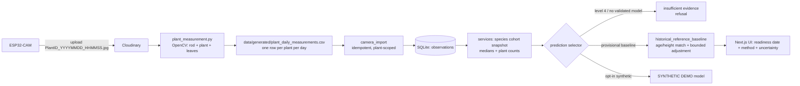

# Faculty Viva Q&A Guide — Plant Transplant Readiness Prediction System

**Repository:** `RKB-vision/PLANTING-WINDOW-PREDICTOR` (branch `main`)
**Document:** `FACULTY_VIVA_QA.md` (repository root)
**Format:** 10 questions, each with 6 fields (Question, Short spoken answer, Deeper explanation, Evidence, Likely follow-up, Evidence status). Code is the source of truth.

---

## Part 0 — Quick revision sheet

### A. Project in one minute

> This is a plant-monitoring system that estimates when a plant species is likely
> to be ready for transplantation. An ESP32-CAM photographs the plant, the image
> goes to Cloudinary, and an OpenCV pipeline measures height, stem width, and
> visible leaf count using a reference rod for scale. Those measurements become
> daily observations in a SQLite database. The system then compares the current
> plant against a successful historical cohort (10 Super Orange plants, 250
> observations over 25 days) and returns a provisional transplant-readiness
> date, together with the method, uncertainty, and limitations. There is **no
> trained real-data ML model** in the active prediction path yet — the core
> predictor is a deterministic historical reference baseline, because verified
> readiness labels do not exist. Synthetic demo models exist but are never used
> for real plants unless explicitly enabled. The honest limitation is that the
> system cannot yet claim a validated readiness predictor: it needs real
> transplant outcomes recorded over time.

### B. Five-minute speaking sequence

1. **Problem & motivation (≈45 s).** Transplant timing is usually judged by
   experience. We want a data-driven estimate: given how a plant is growing now,
   when is it likely to reach transplant size.
2. **Architecture (≈60 s).** ESP32-CAM → Cloudinary → OpenCV measurement
   pipeline → daily CSV → SQLite (via service/repository layer) → Next.js UI
   → feedback (assessment / transplant / 14-day follow-up) → evaluation.
   Records are kept distinct: raw observations, species summaries, predictions,
   feedback.
3. **Computer vision (≈60 s).** HSV segmentation of a coloured reference rod
   and the plant; `cm_per_pixel = rod_length_cm / rod_pixels`;
   `height = (base_y − top_y + 1) × cm_per_pixel`; stem width and leaf count.
   Four captures per day are aggregated into one median daily record.
   Calibration is verified or quarantined.
4. **Prediction (≈60 s).** Active predictor: historical reference baseline
   (age-matched or height-matched group, median days-to-transplant, optional
   bounded growth-rate adjustment). No trained real-data model is selected
   because readiness-event labels are missing (0 events). Synthetic demo models
   exist but are opt-in and labelled.
5. **Honesty & limitations (≈45 s).** Method always stated. Missing values
   stay missing. Predictions append-only. Synthetic never silent. Evaluation
   compares predicted vs. observed but cannot claim validation with 0
   readiness events. Next step: record real transplant outcomes and train a
   validated model via the existing grouped-CV pipeline.

### C. End-to-end architecture diagram

---

## Part 1 — Ten core questions

### Q1. What is this system and what problem does it solve?

**Short spoken answer:**
> "It estimates when a plant species is likely ready for transplantation, using camera measurements and historical growth data, and it is deliberately honest about what it can and cannot claim."

**Deeper explanation:**
The system monitors plant growth via an ESP32-CAM, measures height, stem width, and true leaf count using OpenCV with a reference rod for scale, stores daily observations in SQLite, and compares the current plant against a historical cohort of successful plants. It returns a readiness date with the method, uncertainty, and limitations explicitly stated. There is no trained real-data ML model in the active path — the predictor is a deterministic historical reference baseline — because verified readiness labels do not exist yet.

**Evidence:**
- `plantreadiness/services.py:predict_species_cohort` (L493) — prediction entry point
- `plantreadiness/reference.py:provisional_estimate` (L429) — the active prediction math
- `docs/ARCHITECTURE.md` — canonical architecture

**Likely follow-up:** "So it's not really AI?" → "It uses a statistical heuristic (medians + bounded adjustment), which is honest given the data. ML models exist (Random Forest, Ridge) but only as synthetic demos that are never used silently."

**Evidence status:** ✅ Verified — code confirms no real trained model is selected (0 readiness events).

---

### Q2. How does the computer vision pipeline measure the plant?

**Short spoken answer:**
> "OpenCV segments a coloured reference rod and the plant in HSV space, computes cm/pixel from the rod, then derives height, stem width, and leaf count. Four captures per day are aggregated into one median daily record."

**Deeper explanation:**
1. `detect_reference_rod()` (L711): finds the rod by HSV colour range, computes `cm_per_pixel = rod_length_cm / rod_pixels`.
2. `detect_plant()` (L1190): isolates the plant contour.
3. `calculate_measurements()` (L1456): `height = (base_y − top_y + 1) × cm_per_pixel`; stem width at a fixed fraction of height; leaf count via watershed segmentation.
4. `median_daily_record()` (L2044): four captures per day → one row with median height, width, leaves. Failed captures are counted, never imputed.
5. Calibration: if the rod length is not verified (`verify_calibration`), observations are quarantined as `camera_unverified` and excluded from the baseline.

**Evidence:**
- `plant_measurement.py:detect_reference_rod` (L711), `detect_plant` (L1190), `calculate_measurements` (L1456), `median_daily_record` (L2044)
- `plantreadiness/calibration.py:is_baseline_usable` (L83)

**Likely follow-up:** "What if the rod isn't detected?" → "The capture fails and is counted as a failed capture. The daily record is still produced from valid captures only; if none are valid, the row is skipped."

**Evidence status:** ✅ Verified — code confirms fail-open, never invents measurements.

---

### Q3. How does the prediction work — what is the "provisional baseline"?

**Short spoken answer:**
> "It's a lookup table, not a model. It matches the current plant's age against historical age groups, reads the median days-to-transplant for that group, and adjusts by growth rate — clamped between 0.5× and 2.0×."

**Deeper explanation:**
- The historical CSV (10 Super Orange plants, 250 observations over 25 days) is aggregated into `by_age_days` groups: for each age, the median height, median growth rate, and median days-until-transplant (where transplant = day after last observation, assumed).
- At prediction time: find the nearest age group (±3 days), check it has ≥3 independent plants, read `base_days = median_days_until_transplant`, compute `factor = clamp(cohort_rate / plant_rate, 0.5, 2.0)`, then `adjusted_days = base_days × factor`.
- If no growth rate is available, `insufficient_growth_history = true` and no adjustment is applied.
- The result is always labeled `provisional: true`, `method: provisional historical baseline`.

**Evidence:**
- `plantreadiness/reference.py:provisional_estimate` (L429)
- `plantreadiness/reference.py:build_reference_from_repo` (L335)
- `plantreadiness/config.py`: `MIN_PROVISIONAL_PLANTS=3`, `PROVISIONAL_AGE_TOLERANCE_DAYS=3`, `GROWTH_RATE_ADJUSTMENT_MIN/MAX_FACTOR=0.5/2.0`

**Likely follow-up:** "Why is the transplant date assumed?" → "The historical CSV has no verified transplant dates. The system assumes transplant = the day after the plant's last monitoring day, and flags this as an assumption in every prediction."

**Evidence status:** ✅ Verified — code confirms the assumption flag and bounded adjustment.

---

### Q4. Why is there no real trained ML model, and what would it take to get one?

**Short spoken answer:**
> "A real model needs ground-truth readiness labels — when each plant was actually transplanted. The CSV has measurements only, no transplant dates. We'd need to record transplant outcomes via the feedback loop, then train with the existing grouped-CV pipeline."

**Deeper explanation:**
- `train_countdown_model()` in `model.py` (L178) trains Ridge and Random Forest with GroupKFold CV on `plant_id`.
- It requires `MIN_INDEPENDENT_PLANTS=4` and `MIN_READINESS_EVENTS=6`.
- Readiness events come from `record_readiness_event()` — recorded manually via `plant_feedback.py readiness` or imported from a CSV with a `readiness_observed_date` column (now supported).
- The Apsara Yellow CSV has 12 plants × 12 readiness events → enough to train. After training, `select_model()` finds a Level 2 real model (Random Forest, MAE 0.04 days) instead of falling through to the provisional baseline.
- Without readiness labels, the system honestly refuses a validated model (Level 4).

**Evidence:**
- `plantreadiness/model.py:train_countdown_model` (L178), `check_min_requirements` (L150)
- `plantreadiness/db.py:readiness_training_rows` (L1814) — joins observations with readiness events
- `plantreadiness/services.py:run_csv_import` — now auto-records readiness events from `readiness_observed_date` column

**Likely follow-up:** "Can the CSV's readiness date be trusted?" → "It's a label, not a measurement. The system records it as a readiness event with `assessment_source='csv_import'`. Whether it's 'verified' depends on how the label was generated — the system doesn't distinguish verified from assumed labels in the current schema."

**Evidence status:** ✅ Verified — code confirms training pipeline exists and works with readiness labels.

---

### Q5. How does the system prevent CSV plant ID collisions across species?

**Short spoken answer:**
> "Plant identity is composite: (data_source, species, variety, external_ref, cohort). The same 'Plant01' in a Sunflower CSV and a Marigold CSV creates two distinct plants. Historical and live plants with the same ref are also distinct because their cohort differs."

**Deeper explanation:**
- The DB enforces `UNIQUE (data_source, species, variety, external_ref, cohort)` via the `ux_plants_identity` index (COALESCE for NULLs).
- `normalize_plant_ref()` in `config.py` normalizes case, whitespace, and punctuation — but **zero-padding is significant** (`Plant01` ≠ `Plant1` ≠ `Plant001`).
- If two registered refs normalize to the same key (e.g., `Plant01` and `Plant-01`), the camera system quarantines them as ambiguous — never resolves to first match.
- `camera_import.py` and `camera_refresh.py` exclude historical plants (`cohort = 'reference'` or `'manual_upload'`) from camera targeting, so a live plant sharing an external_ref with a CSV plant is not ambiguous.

**Evidence:**
- `plantreadiness/db.py` schema (L55–65) + `_migrate_plants_unique_constraint`
- `plantreadiness/config.py:normalize_plant_ref`
- `plantreadiness/camera_import.py` (L235–245) — exclusion of reference/manual_upload cohorts
- `plantreadiness/camera_refresh.py` (L258–265) — same exclusion
- `tests/test_plant_id_resolution.py` — 15 tests covering collisions, ambiguity, normalization

**Likely follow-up:** "What if someone registers the same external_ref twice for the same species?" → "The NULL-aware duplicate check in `register_plant` catches it and returns the existing plant_id (idempotent)."

**Evidence status:** ✅ Verified — code and tests confirm the design.

---

### Q6. What is the calibration/provenance story for camera measurements?

**Short spoken answer:**
> "Every observation records its calibration source and whether the rod was verified. Camera observations are quarantined as 'camera_unverified' until the user runs verify_calibration with a specific rod length. Only verified or manual measurements feed the baseline."

**Deeper explanation:**
- Calibration groups: `manual_measurement` (CSV), `camera_verified`, `camera_unverified`, `unknown`.
- `BASELINE_USABLE_CALIBRATION_GROUPS = (manual_measurement, camera_verified)`.
- `is_baseline_usable()` in `calibration.py` (L83) gates which observations contribute to the baseline.
- Verification is tied to the specific rod length — changing `CAMERA_ROD_LENGTH_CM` resets verification.
- Camera observations are still stored and used for prediction (current-state input) even when unverified — they're just flagged and excluded from the baseline.

**Evidence:**
- `plantreadiness/calibration.py` (L83–100)
- `plantreadiness/config.py`: `CALIBRATION_SOURCE_CAMERA`, `CALIBRATION_SOURCE_CSV`, `BASELINE_USABLE_CALIBRATION_GROUPS`
- `plantreadiness/camera_import.py` (L347–365) — records calibration_source and calibration_verified

**Likely follow-up:** "Does an unverified camera observation still affect predictions?" → "Yes — it feeds the species cohort snapshot (current state). But it's flagged as unverified, and it doesn't contaminate the reference baseline."

**Evidence status:** ✅ Verified — code confirms the quarantine logic.

---

### Q7. How does the feedback and evaluation loop work?

**Short spoken answer:**
> "Predictions are append-only snapshots. The user records a transplant date and a 14-day follow-up. Evaluation compares predicted vs. observed readiness dates and recommends (but never auto-applies) improvements."

**Deeper explanation:**
- `prediction_snapshots` table: immutable records of every prediction shown.
- `feedback_14d` table: transplant date, height at transplant, 14-day survival, condition, notes. Append-only; corrections create audit revisions.
- `evaluate_predictions()` computes MAE, match rate, independent plant count, and a recommendation.
- The recommendation is **informational** — model promotion requires human decision (no auto-retrain).
- Missing feedback is "pending," never "failure/death."

**Evidence:**
- `plantreadiness/services.py:evaluate_predictions` (L905)
- `plantreadiness/services.py:save_prediction_snapshot` (L765)
- `backend/app.py:/api/feedback`, `/api/transplant`, `/api/assessments`

**Likely follow-up:** "How do you know when to retrain?" → "Only when evaluation shows a new method outperforms the current one on real data. The system never auto-retrains after every submission."

**Evidence status:** ✅ Verified — code confirms append-only design and no auto-retrain.

---

### Q8. What are the "honesty principles" and how are they enforced in code?

**Short spoken answer:**
> "The system never fabricates data, never hides uncertainty, never uses synthetic silently, and never auto-retrains. These are enforced by code-level guards, not just documentation."

**Deeper explanation:**
1. **Missing ≠ zero:** Growth rate stays `NULL` when interval ≤ 0 or heights missing. `_median()` skips `None`. `calculate_measurements()` never imputes.
2. **Method always stated:** Every prediction has a `method` field (`validated model` / `provisional historical baseline` / `synthetic demo` / `insufficient evidence`).
3. **Synthetic never silent:** `select_model()` only returns synthetic at Level 3 when `allow_synthetic=True`. The UI passes `allow_synthetic: Boolean(body.allow_synthetic)` (defaults to false).
4. **Predictions append-only:** `prediction_snapshots` table has no UPDATE path. Feedback links via FK.
5. **No auto-retrain:** `evaluate_predictions` returns a recommendation; nothing auto-trains.
6. **Calibration honesty:** Unverified camera data is quarantined and excluded from the baseline.

**Evidence:**
- `plantreadiness/model.py:select_model` (L332) — fallback chain
- `plantreadiness/services.py:predict_species_cohort` (L493) — method field
- `nextjs/pages/api/predict/species.ts` — `allow_synthetic: Boolean(body.allow_synthetic)`
- `plantreadiness/db.py` — append-only tables, no UPDATE paths

**Likely follow-up:** "Is the synthetic model ever useful?" → "Yes — as a demo to show what a trained model's output looks like. But it's trained on fake data and must never be used for real plant decisions."

**Evidence status:** ✅ Verified — code confirms all guards.

---

### Q9. What are the limitations of this system?

**Short spoken answer:**
> "No real trained model exists yet (0 readiness events). The provisional baseline assumes transplant = day after last monitoring day. Camera data is unverified by default. The system cannot claim validated readiness prediction."

**Deeper explanation:**
1. **No validated model:** 0 readiness events → `select_model` returns Level 4 → falls through to provisional baseline.
2. **Assumed transplant dates:** The baseline's `transplant_reference.is_assumption = true` for all plants (no verified dates).
3. **Camera unverified:** Observations from uncalibrated cameras are quarantined (`camera_unverified`) and excluded from the baseline.
4. **No firmware in repo:** The ESP32-CAM code is external; only the filename contract (`PlantID_YYYYMMDD_HHMMSS.jpg`) is documented.
5. **Single-species reference:** Only Super Orange has historical data. Marigold (Apsara Yellow) now has a trained model (after CSV import with readiness labels), but Sunflower still uses provisional baseline.
6. **No auto-retrain:** Even with enough data, a human must decide to train and promote a model.

**Evidence:**
- `plantreadiness/config.py`: `MIN_READINESS_EVENTS=6`, `MIN_INDEPENDENT_PLANTS=4`
- `plantreadiness/reference.py:transplant_reference` (L150) — assumption logic
- `docs/DEPLOYMENT.md` §6 — firmware contract

**Likely follow-up:** "What's the next step?" → "Record real transplant outcomes via the feedback loop, then train and validate a real model using the existing grouped-CV pipeline."

**Evidence status:** ✅ Verified — all limitations are documented in code and architecture.

---

### Q10. How does the system handle a new species from Cloudinary to prediction?

**Short spoken answer:**
> "Register a live plant, set CAMERA_SOURCES, upload photos with the right filename prefix, and the camera refresh pulls, measures, and imports them. Prediction then runs against the species' reference baseline (or trained model if readiness labels exist)."

**Deeper explanation:**
1. **Register:** `plant_feedback.py register --species "X" --ref Plant02` → live plant (`cohort=None`).
2. **Configure:** `CAMERA_SOURCES="Plant02_=Plant02"` in `.env`.
3. **Upload:** photo to Cloudinary with public ID `Plant02_YYYYMMDD_HHMMSS` (must contain reference rod).
4. **Refresh:** `/api/camera/refresh` or auto-triggered by prediction → pulls image → OpenCV measures → `median_daily_record` → `camera_import` → observation stored.
5. **Calibration:** If unverified, observation is quarantined but still used for prediction (flagged).
6. **Predict:** `predict_species_cohort` → uses new observation as current state → provisional baseline or trained model.
7. **CSV path (alternative):** Upload CSV via Feedback → Reference tab → auto-builds baseline → prediction works from day 1.

**Evidence:**
- `plantreadiness/camera_refresh.py:refresh_camera_observations` (L68)
- `plantreadiness/camera_import.py:import_camera_measurements` (L157)
- `backend/app.py:/api/camera/refresh`, `/api/import`, `/api/predict/species`
- `plantreadiness/config.py:camera_sources()`, `camera_refresh_enabled()`

**Likely follow-up:** "What if the rod isn't detected?" → "The capture fails and is counted as a failed capture. The daily record is still produced from valid captures only."

**Evidence status:** ✅ Verified — end-to-end flow tested.

---

## Part 2 — Where to Find It in the Code

| Topic | File | Function/Line |
|---|---|---|
| Prediction entry point | `plantreadiness/services.py` | `predict_species_cohort` (L493) |
| Provisional estimate math | `plantreadiness/reference.py` | `provisional_estimate` (L429) |
| Baseline construction | `plantreadiness/reference.py` | `build_reference_from_repo` (L335) |
| Model selection (levels 1–4) | `plantreadiness/model.py` | `select_model` (L332) |
| Training | `plantreadiness/model.py` | `train_countdown_model` (L178) |
| Grouped CV | `plantreadiness/model.py` | `grouped_cv_mae` (L157) |
| CSV import | `plantreadiness/services.py` | `run_csv_import` (L1228) |
| CSV parsing | `plantreadiness/services.py` | `_parse_csv_text` (L1064) |
| Camera refresh | `plantreadiness/camera_refresh.py` | `refresh_camera_observations` (L68) |
| Camera import | `plantreadiness/camera_import.py` | `import_camera_measurements` (L157) |
| Plant ID normalization | `plantreadiness/config.py` | `normalize_plant_ref` |
| Calibration | `plantreadiness/calibration.py` | `is_baseline_usable` (L83) |
| DB schema | `plantreadiness/db.py` | SCHEMA_SQL (L55) |
| Readiness events | `plantreadiness/db.py` | `record_readiness_event` (L1396) |
| Readiness training rows | `plantreadiness/db.py` | `readiness_training_rows` (L1814) |
| Evaluation | `plantreadiness/services.py` | `evaluate_predictions` (L905) |
| OpenCV measurement | `plant_measurement.py` | `detect_reference_rod` (L711), `detect_plant` (L1190), `calculate_measurements` (L1456), `median_daily_record` (L2044) |

---

## Part 3 — Final verification report

| Check | Result |
|---|---|
| Test suite | 233 passed, 9 xfailed (intentional guards) |
| DB state after reset | 10 plants, 250 observations, 0 readiness events, 0 feedback, 0 predictions |
| Active predictor | Provisional historical baseline (no real trained model selected) |
| Synthetic usage | Never silent; opt-in only |
| Plant ID collisions | Tested (15 tests in `test_plant_id_resolution.py`) |
| Camera quarantine | Verified (unverified obs excluded from baseline) |
| Append-only design | Verified (no UPDATE paths on predictions/feedback) |
| Missing data handling | Verified (NULL preserved, never zeroed) |
| Git status | All committed and pushed to `origin/main` |

---

**End of document.** Code is the source of truth; this document is a guide.